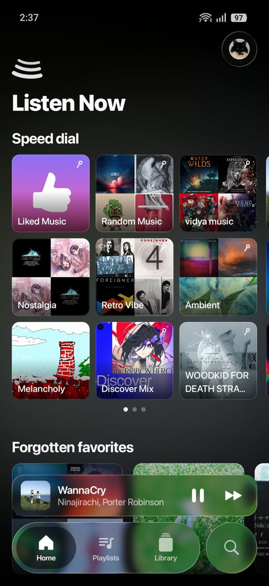
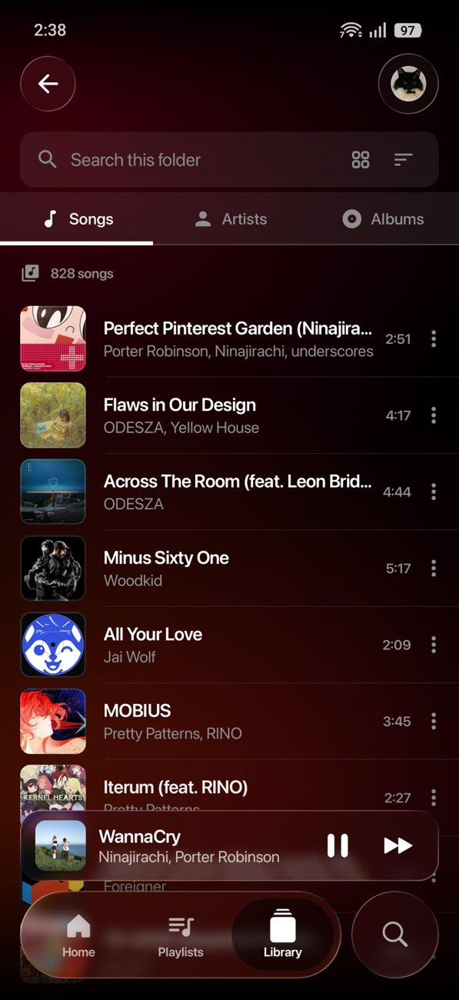
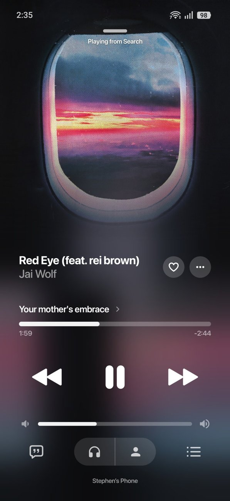
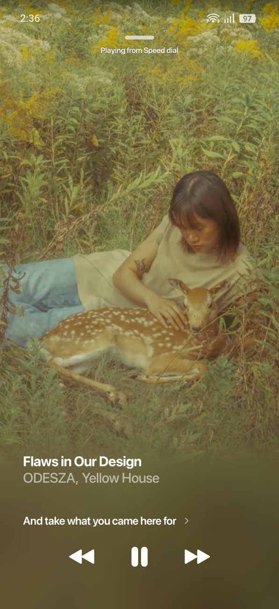
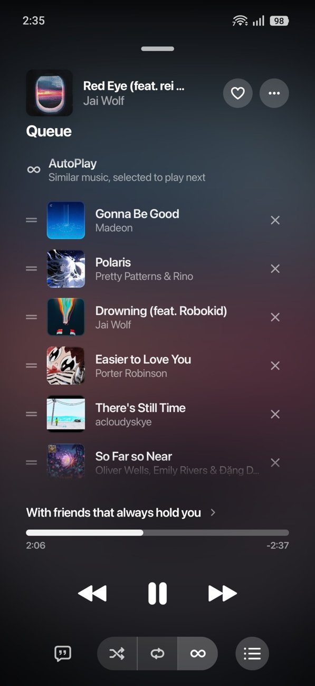
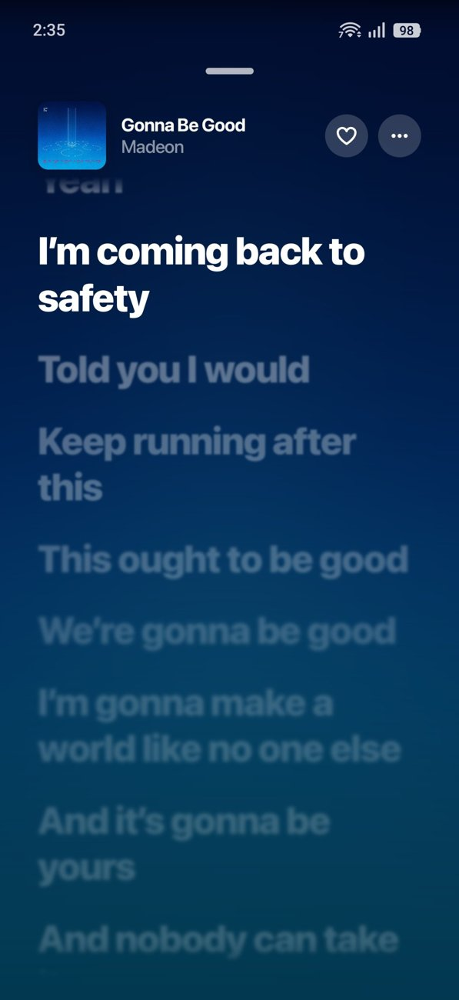

# BitChord, customized

### A personalized fork of the BitChord YouTube Music client

[**Screenshots**](#screenshots) · [**What's different**](#whats-different-in-this-fork) · [**Install**](#install-and-updates) · [**Credits**](#credits)

> [!NOTE]
> This is a fork of [BitChord](https://github.com/kushagrasinghx/BitChord) by [kushagrasinghx](https://github.com/kushagrasinghx). Everything BitChord does (Hi-Res audio, crossfade, word-synced lyrics, Spotify, scrobbling and the rest) is still here. This page covers only what the fork adds or changes. For the full upstream feature list, see the [original README](https://github.com/kushagrasinghx/BitChord#features).

> [!IMPORTANT]
> Not affiliated with, endorsed by, or connected to YouTube or Google in any way. Use it at your own discretion.

---

## Screenshots

<table>
  <tr>
    <td align="center"> Speed dial and a custom nav bar</td>
    <td align="center"> YouTube Music library</td>
    <td align="center"> Now playing</td>
  </tr>
  <tr>
    <td align="center"> Compact controls over Spotify Canvas</td>
    <td align="center"> Queue with compact controls</td>
    <td align="center"> Lyrics</td>
  </tr>
</table>

---

## What's different in this fork

### Your own music
- **Play your uploaded YouTube Music songs.** Tracks you uploaded to your YouTube Music library now play like any other song.
- **A "YouTube Music" category in the Library tab** that shows your whole YouTube Music library (Songs, Artists, Albums), cached so it doesn't reload every time you open it.
- **Pick a default library.** Long-press a library, or choose it in Settings, and tapping Library on the nav bar goes straight there. You can also choose which page it opens on. The back arrow in the top-left returns to the main library page.
- **List or grid per library tab**, and a **Last played** sort.
- **An A–Z index** down the side of library lists sorted by name: touch or drag a letter to jump there.

### Home
- **Speed dial.** Pin songs, albums, playlists and more to a speed dial on Home, as a 3 × 4 grid (or 3 × 3, in Settings) that fits above the miniplayer. Hold a pin and drag it to reorder, like a phone's home screen: the pins shrink a little and jiggle while the rest dim, and holding at the edge moves it to another page. The tiles are always square.
- **Dial menus.** Hold any tile for its menu, which can also take it off the dial. An artist's menu has View artist, add to or remove from the speed dial, Shuffle, Start radio and Favorite artist (the star on their page).
- **I'm Feeling Lucky.** A die on the speed dial: tap it and its lights chase round like a spinner, then land on a face from one to six as a radio starts off a random pick from what you've played lately, had on heavy rotation or liked. A pool of about twenty picks is gathered once per session and re-rolled on every tap. Can be turned off in Settings › Layout.
- **An artists' dial.** A second page under the speed dial of the artists you pin, then the ones you play most; tap one for their page. The title beside the logo follows along: your dial's name, then "Artists", then "Explore" for the sections below. Can be turned off in Settings › Layout, which puts pinned artists back on the speed dial.
- **Reorder the Home layout** and **hide sections** you don't use.
- **A title you can rename.** "BitChord Dial" sits beside the logo in Metropolis; hold it to type your own.
- **The dial is Home's first screen.** Everything else on Home sits below it, behind a faint chevron, and only loads once you swipe down to it.
- **A logo made of squares.** It stays pinned in the top left as you scroll, at full size, with a soft blur along the top of the screen under it once you're down in Explore, and pulling down to refresh lights the squares up in a spin, then settles them back into the logo.

### Navigation
- **Customize the nav bar.** Reorder the tabs, or swap one out for a **Playlists** shortcut.
- **Keep the miniplayer and navigation bar expanded** instead of collapsing as you scroll.
- **A miniplayer that shows how far through the song you are**, as a glow in the cover's colour along its bottom (a thin line without liquid glass). Swipe it sideways and the next or previous song slides in; the skip button is optional, in Settings › Layout.
- Choose which screen the app **starts on**, and whether the miniplayer is **circular or a rounded square**.

### Appearance
- **Ambient background.** Soft, slowly drifting colour blobs sit behind the app, with frosted surfaces on top. The colour can **match the current song's album art**, or stay on a fixed colour (green in Spotify libraries, red in YouTube Music).

### Artist pages
- **Pin and radio buttons.** A pin beside the star puts the artist on your dial, and a Start radio button sits left of Shuffle. With liquid glass on, every button and box on the page is glass.

### Player
- **Spotify Canvas with controls that stay.** When a Canvas video is playing, the player controls shrink and stay visible instead of fading out. You can turn this off again in the Canvas settings.
- **A cleaner queue.** The redundant entries are gone: the current song is at the top and the next songs follow below. Scroll up to see what you already played. The player controls shrink to make room for more of the queue, and shrink the same way on the lyrics screen.
- **Gestures.** Swipe up on the controls area to open the queue, and swipe down to close it. Swipe down on the player screen to minimize it. The system back gesture plays the same slide-down.

### Under the hood
- A launch screen that builds the logo square by square while the app loads, then opens on the speed dial as it fades in tile by tile.
- Album art loads a small copy first, and prefetches the next tracks, so the player and its blur keep up on mobile data.
- Thumbnails that aren't square are cropped to fill, with YouTube's black bars trimmed off (Settings › Layout › Crop thumbnails).
- The Home feed and library pages are cached on disk and in memory for a faster start.
- Builds are optimized for speed.

---

## Install and updates

Download the latest APK from the [Releases](https://github.com/steeben/BitChord/releases) page. Sideloading requires enabling "Install unknown apps" for whichever app you download it with.

> [!TIP]
> I suggest using [ObtainX](https://github.com/bikram-agarwal/ObtainX) ([F-Droid](https://f-droid.org/packages/dev.bikram.obtainx/)) for automatic updates. Add this repository to it and it will pick up new releases as they are published.

The app installs as **BitChord Dial**, a separate app from the official BitChord, so the two can sit side by side and neither touches the other's data. You'll need to sign in again the first time.

Each release is signed with the same key, so a new version installs over the old one and keeps your sign-in and settings. The app also checks this repository for updates when it launches.

To build it yourself, see [CONTRIBUTING.md](CONTRIBUTING.md) and, for the desktop app, [DESKTOP.md](DESKTOP.md).

---

## Credits

This project exists because of [BitChord](https://github.com/kushagrasinghx/BitChord) and its contributors. The lyrics providers, audio sources and everything else it builds on are credited in the [upstream README](https://github.com/kushagrasinghx/BitChord#features). The uploaded-songs fix draws on how [Metrolist](https://github.com/MetrolistGroup/Metrolist) and its InnerTube library handle uploads.

If you like BitChord, consider [supporting its author](https://github.com/kushagrasinghx/BitChord#support).

## Disclaimer

BitChord is an independent, community-driven third-party audio player and client. It is **not** associated with Google LLC, YouTube Music, Deezer, Telegram, or any of their parent companies. It does not host, upload, or store copyrighted music files, and it is provided for personal, educational and fair-use purposes. You are responsible for ensuring your use follows your local copyright laws and the YouTube Terms of Service.

## License

Licensed under the **GNU General Public License v3.0**. See [LICENSE](LICENSE).
